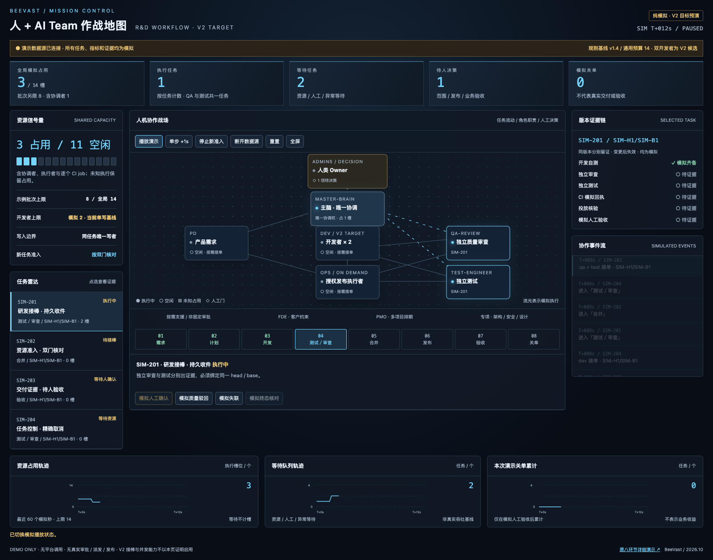

# 人 + AI Team 作战地图 V2 — 审阅稿

打开 `demos/workflow-team-v2.html`，无需安装依赖或连接平台。可用 Python 静态服务本地预览：`python3 -m http.server 35489 --bind 127.0.0.1`。

## 本地作者验证 / 2026-10-31

`node --test tests/workflow-team-v2.test.cjs tests/workflow-demo.test.cjs`：44个用例通过，含37个原页面既有回归和7个新增状态/页面检查。检查双预算、角色限制、未知占用、head变更证据失效、人工门、停止排空与断线冻结；文字/背景对比度数值检查通过。

本机 Google Chrome headless，经 CDP 实际加载页面。1600×1150及390×844：无横向溢出、地图节点不重叠；实际按钮完成任务选择、模拟验收、失联保留占用、终态核对后停止准入、断线冻结；任务按钮焦点在更新后保留；未捕获页面 JavaScript 异常。原始摘要见 browser-check.json；截图为同一浏览器的模拟T+12秒附近状态，不是真实遥测。

这些是作者本地检查，不是独立QA、远端CI、真实调度/性能/隔离验证或业务验收。模拟质量回执不替代正式门禁；V2目标与当前生效规则分开展示。原workflow-demo.html未修改。

[手机长图](mobile.png)
