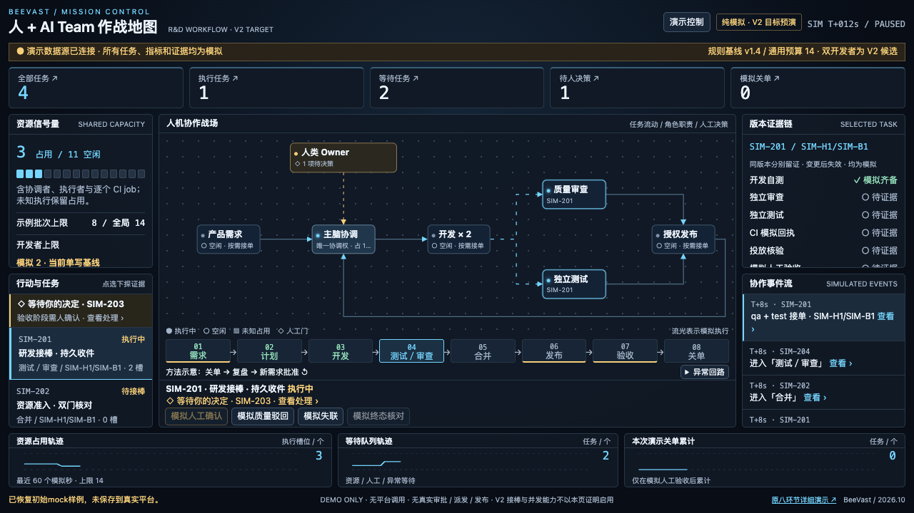
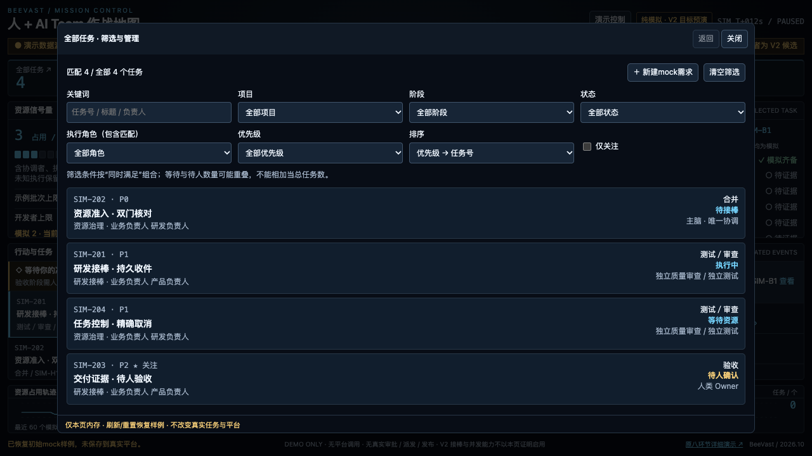

# Mock 指挥与任务中心

方案先经本会话独立质量架构评审，CONDITIONAL ACCEPT约束已纳入。全部操作仅本页内存；刷新/重置恢复4个初始样例，不连接真实调度、审批或任务平台。

作者验证：53个Node自动化用例通过，含原44个回归与9个新增命令模型检查；新增覆盖同源统计与AND筛选、多角色包含、幂等创建与唯一ID、断线模型拒绝、阶段/版本过期拒绝、仅展示字段编辑、动态曲线计数、事件关联与注入文本。

Chrome本地9种CSS视口（1920×1080、1440×900、1366×768、1280×720、1024×768、1024×640、390×844、360×640、720×450）运行原一屏/菜单/箭头检查及新增任务中心脚本。新增实际检查：card→列表、组合筛选/空结果/清空、列表详情返回保留查询、编辑中推进时钟草稿不变、断线保存拒绝/草稿保留、输入转义、新建不匹配筛选提示、12任务时动态曲线、角色/曲线/全域事件下探、未知占用告警、编辑中跨断点、ESC恢复焦点。正交线段额外检查不穿越无关节点内部。

9种是视口数，不是9个测试用例；720×450是等效小视口，未实测200%缩放、Safari或真实手机地址栏。作者结果不替代独立固定HEAD复核。

[手机首页](360x640.png) · [手机任务中心](360x640-tasks.png)
