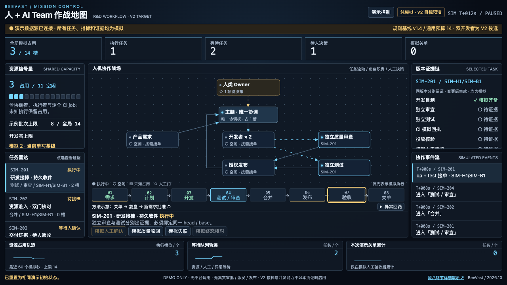

# 2026-11-01 一屏布局

作者本地浏览器矩阵：1920×1080、1440×900、1366×768、1280×720、1024×768、1024×640、390×844、360×640、720×450。各尺寸检查默认/切任务/环节说明/断线长提示/模拟执行状态；页面无双向溢出、布局视口不扩张、节点不相交/越界、八阶段完整、箭头端点绑定实际边界。所有尺寸另测演示控制展开后全部按钮边界、逐Tab可达及暂停实际点击，异常回路Space展开后的边界；紧凑模式另测原生详情对话框Escape关闭和焦点恢复。720×450仅为等效小视口，未亲测浏览器200%缩放。结果见browser-results.json。

模型44个自动化用例通过，含37个既有回归、7个原V2检查。独立质量架构复核另附，不将作者结果称为独立复测。

重跑：开启本地Chrome调试端口和HTTP静态服务；`CDP_PORT=<port> DEMO_ORIGIN=http://127.0.0.1:<port> node tests/workflow-team-layout.browser.cjs`。

[360×640手机](360x640.png)
